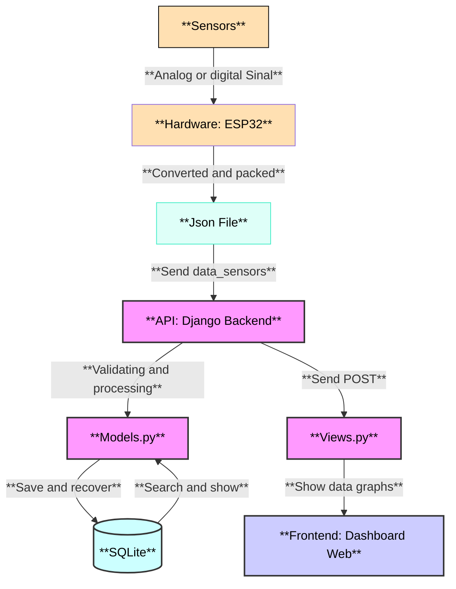

# EcoView - Sistema de Visualização de Dados em Tempo Real


Sistema completo para coleta, armazenamento e visualização de dados em tempo real de sistemas desenvolvidos pelo Grupo de Pesquisas em Modelagem HidroAmbiental e Ecotecnologias da UFSM.

## Sumário
- [Funcionalidades](#funcionalidades)
- [Tecnologias Utilizadas](#️-tecnologias-utilizadas)
- [Como Usar](#como-usar)
- [Autenticação RFID](#autenticacao-rfid)
- [Arquitetura de Software](#arquitetura-de-software)
- [Contribuição](#contribuição)
- [Licença](#licença)
- [Contato](#contato)

## Funcionalidades

- Coleta de dados em tempo real via API REST
- Dashboard interativo com gráficos dinâmicos (Chart.js)
- Gerenciamento de dados com tabelas paginadas e filtros
- Suporte a múltiplos sensores e dispositivos
- Exportação de dados (CSV, JSON, Excel)
- Atualização de firmware OTA (Over the Air)
- **Autenticação de acesso via cartão RFID**

## 🛠️ Tecnologias Utilizadas

| Componente | Tecnologias                                                         |
|------------|---------------------------------------------------------------------|
| Backend    | Python 3.9+, Django 4.2, Django REST Framework, SQLite              |
| Firmware   | C++ (Arduino Core), ESP32/ESP8266                                   |
| Frontend   | HTML5, Bootstrap 5, Chart.js (para gráficos de histórico)           |
| Sensores   | DS18B20, DHT-11, UV, Anemômetro                                    |
| RFID       | Leitor RFID + ESP8266                                               |

## Como Usar

- Acesse o sistema pelo navegador (endereço do servidor).
- Cadastre-se e aguarde autorização do administrador.
- Após login, acesse o dashboard para visualizar dados em tempo real.
- Exporte dados conforme necessário.

## Autenticação RFID

O sistema permite cadastrar cartões RFID e controlar o acesso físico via ESP8266:
- Cadastre os cartões RFID pelo painel de administração.
- A ESP8266 envia o UID do cartão via POST para `/api/verifica_cartao/`.
- O backend responde se o cartão está autorizado (`{"autorizado": true}` ou `false`).
- A ESP8266 pode então liberar ou negar o acesso conforme a resposta.

### Registro de ponto por RFID

Além do controle de acesso, o projeto agora registra ponto automaticamente quando o ESP8266 envia o UID para:

```text
POST /api/ponto/
```

O backend grava:
- Nome do aluno
- UID do cartão
- Data e hora exatas
- Tipo de batida alternando entre **ENTRADA** e **SAÍDA**

O firmware pronto está em:

```text
hardwares/esp8266_rfid_ponto.ino
```

### Como gravar os alunos e associar os UID

Execute o script abaixo para criar/atualizar os usuários IC e vincular os cartões:

```bash
python scripts/seed_ic_cards.py
```

Para simular sem salvar nada:

```bash
python scripts/seed_ic_cards.py --dry-run
```

UID cadastrados no script:

| UID | Nome |
|---|---|
| `0417796A2F6481` | Luize Baldoni |
| `047D4B6A2F6480` | Gabrielle Barcellos |
| `0485EB622F6480` | Lyncoln Jurich |
| `04C6676A2F6480` | Eduarda Schossler |
| `0472EA622F6480` | Amanda Belitz |

### Exemplo de integração no ESP8266

O firmware envia o UID via `POST` em `text/plain` para o endpoint do Django. O servidor responde com JSON indicando se o ponto foi registrado com sucesso.

Exemplo de requisição ESP8266:
```cpp
HTTPClient http;
http.begin("http://SEU_SERVIDOR/api/verifica_cartao/");
http.addHeader("Content-Type", "application/json");
String payload = "{\"uid\":\"12345678\"}";
int httpResponseCode = http.POST(payload);
String resposta = http.getString();
http.end();
```

## Arquitetura de Software


## Contribuição

1. Faça um fork do repositório
2. Crie uma branch (`git checkout -b feature/nova-feature`)
3. Realize os commits das suas alterações
4. Envie um Pull Request

## Licença

Este projeto está sob a licença MIT.

## Contato

Para dúvidas, sugestões ou colaborações, entre em contato:
- [Seu Nome](mailto:seu.email@exemplo.com)  
- Grupo de Pesquisas em Modelagem HidroAmbiental e Ecotecnologias - UFSM
- [LinkedIn](https://www.linkedin.com/in/seu-perfil)
